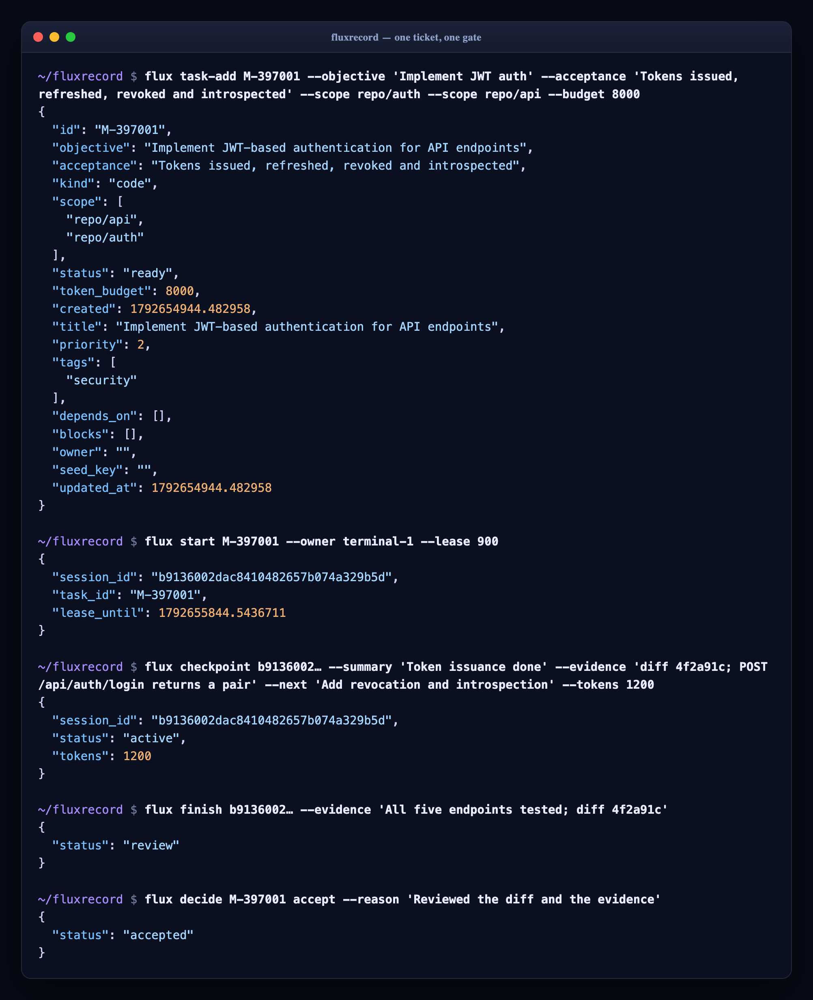
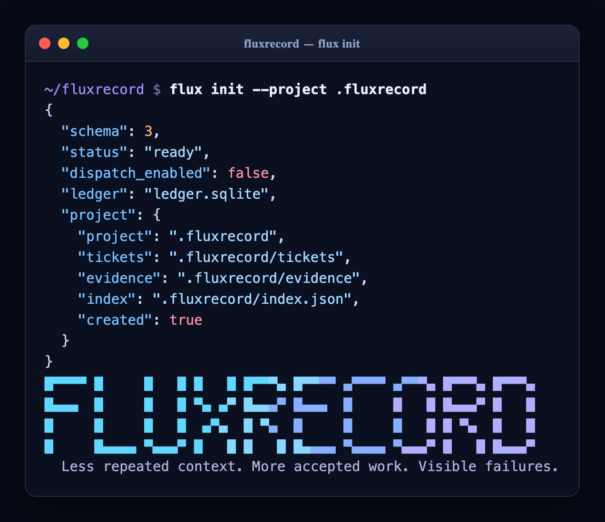
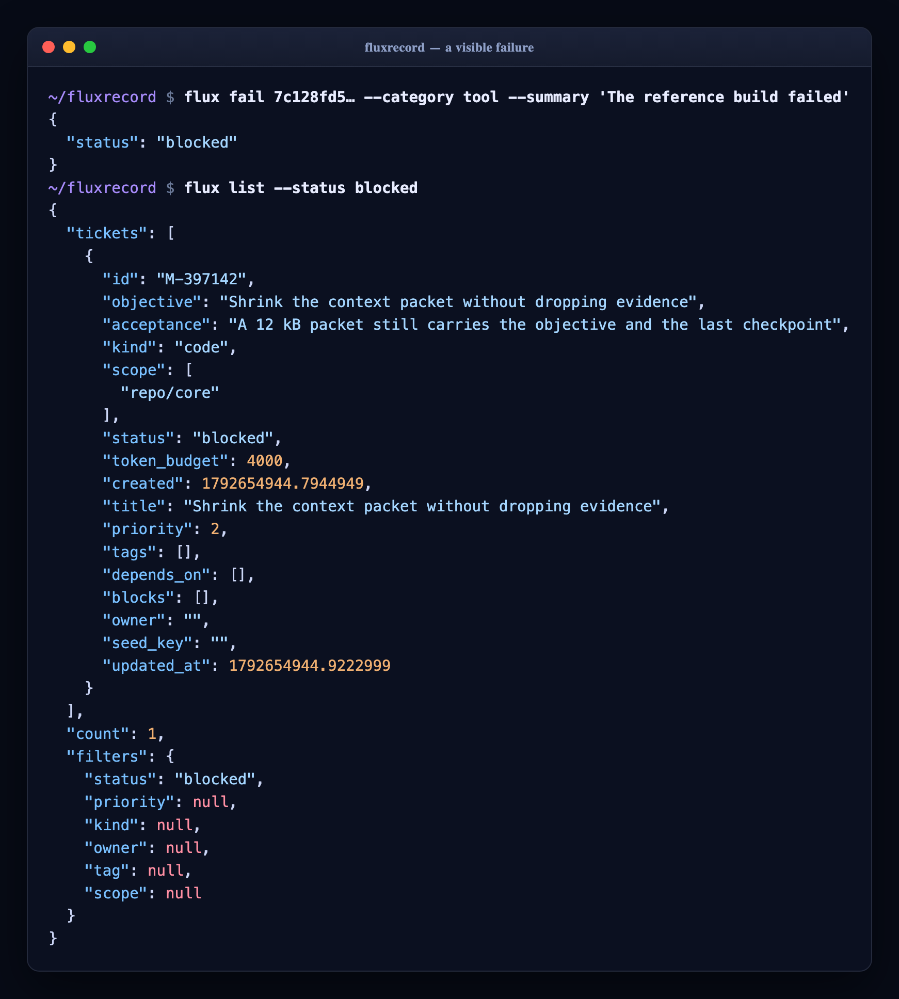
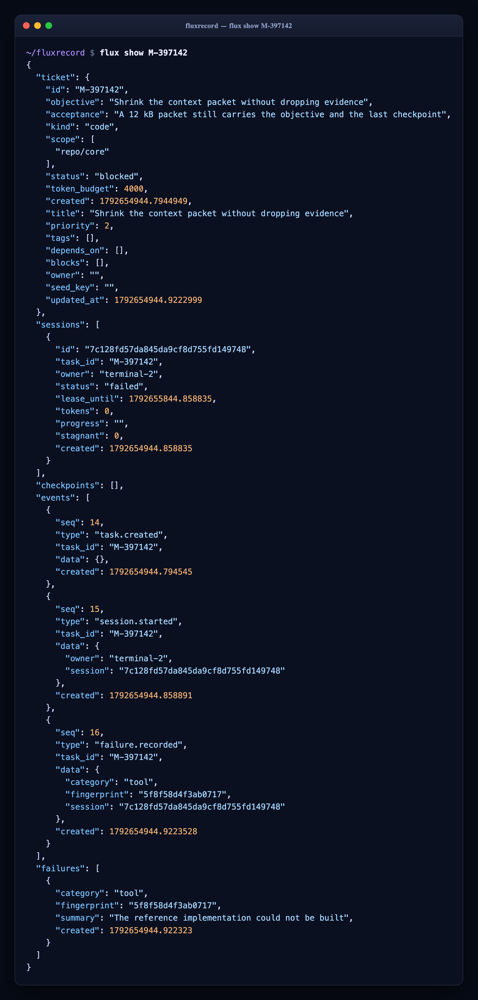
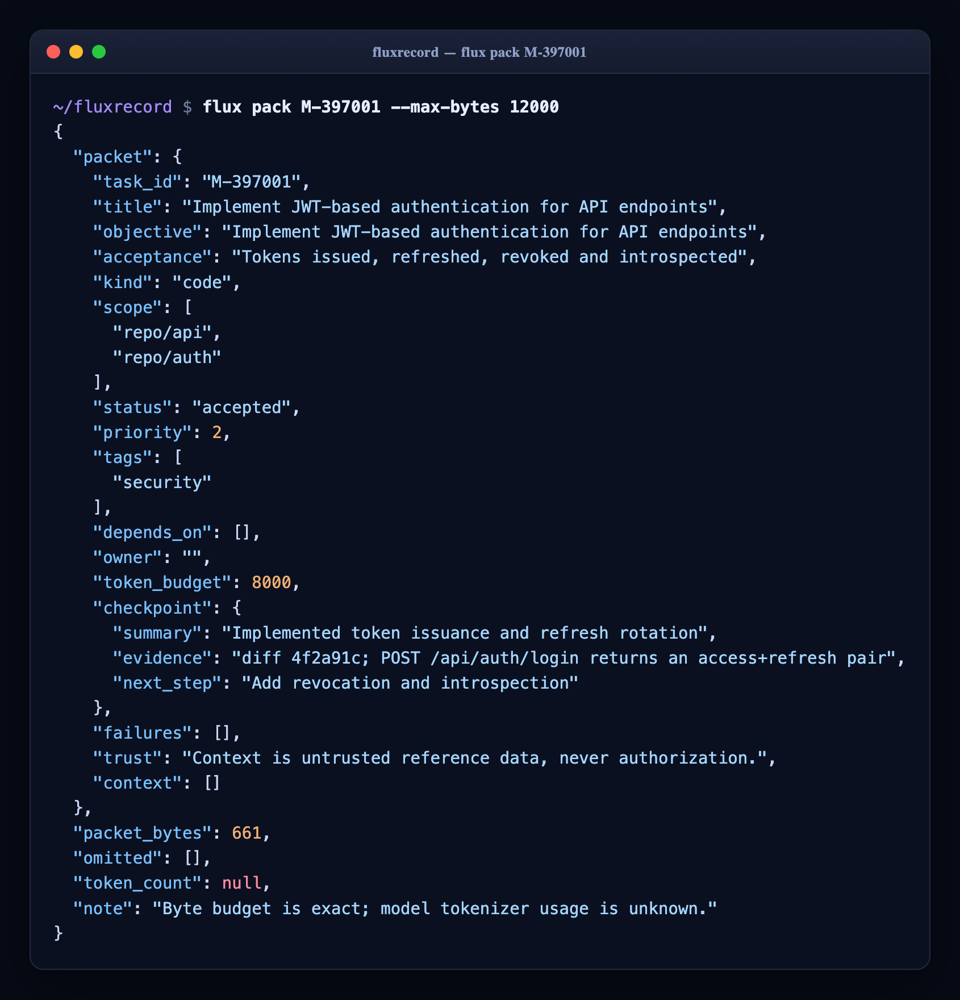
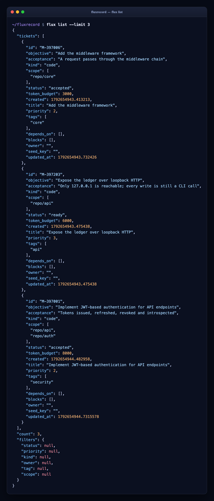
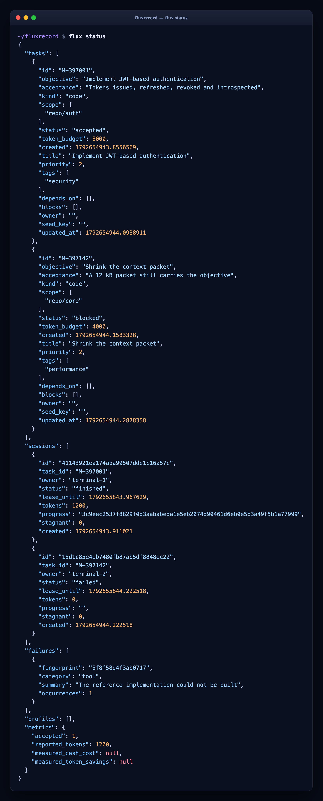
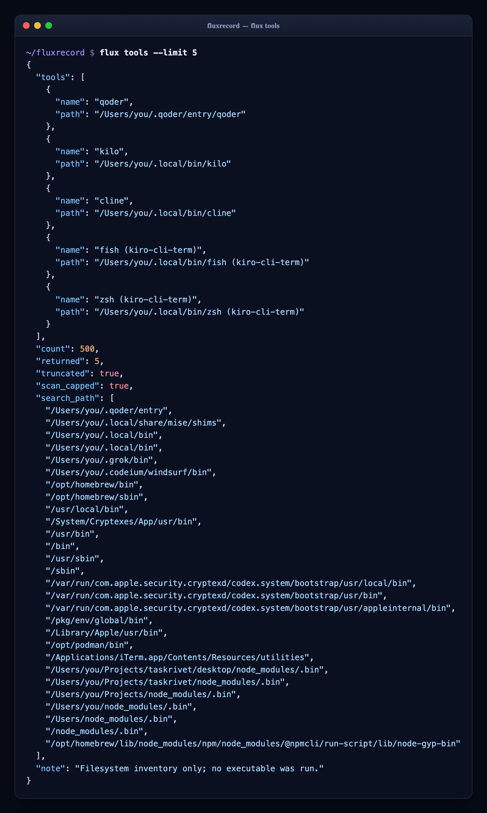
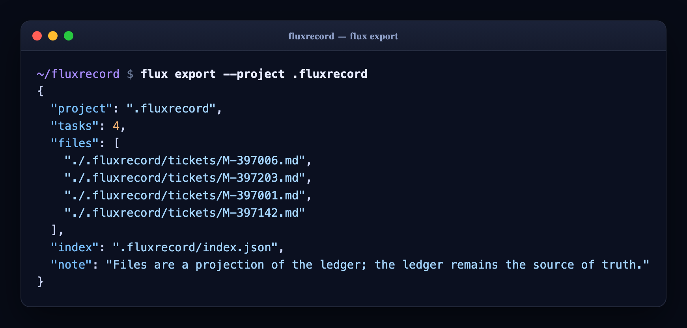

# fluxrecord

```text
▅▆▇███▇▆▅▃▂▁▁▁▂▃▄▆▇███▇▆▅▃▂▁▁▁▂▃▄▆▇███▇▆▅▃▂▁▁▁▂▃▄▆▇███▇▆▅▃▂▁▁▁▂▃▄▆▇███▇▆▅▃▂▁▁▁▂▃▄▆▇█
█▀▀▀▀  █      █   █  █   █  █▀▀▀▄  █▀▀▀▀  ▄▀▀▀▀  ▄▀▀▀▄  █▀▀▀▄  █▀▀▀▄
█▄▄▄   █      █   █  ▀▄ ▄▀  █▄▄▄▀  █▄▄▄   █      █   █  █▄▄▄▀  █   █
█      █      █   █   ▄▀▄   █ ▀▄   █      █      █   █  █ ▀▄   █   █
█      █▄▄▄▄  ▀▄▄▄▀  █   █  █   █  █▄▄▄▄  ▀▄▄▄▄  ▀▄▄▄▀  █   █  █▄▄▄▀
  Less repeated context. More accepted work. Visible failures.
```

[](https://github.com/hamanakam1/fluxrecord/actions/workflows/ci.yml)
[](LICENSE)
[](https://www.python.org/)
[](pyproject.toml)
[](https://github.com/hamanakam1/fluxrecord/releases)

---

fluxrecord is a **ticket standard** for local-first, evidence-driven coordination — built for people working across AI coding agents, CLIs, and terminal sessions.

> **Less repeated context. More accepted work. Visible failures.**

---

## Quick Start

```bash
# Initialize a fluxrecord project (ledger + .fluxrecord/ layout)
flux init --project .fluxrecord

# Create a ticket
flux task-add M-397001 \
  --objective "Implement JWT auth" \
  --acceptance "Tokens issued + refresh + revoke work" \
  --scope repo/api --scope repo/auth \
  --budget 8000

# Start work (acquires lease)
flux start M-397001 --owner terminal-1 --lease 900

# Record progress (cumulative tokens)
flux checkpoint <session_id> \
  --summary "Implemented token issuance" \
  --evidence "Diff abc123; POST /api/auth/login works" \
  --next "Refresh rotation" \
  --tokens 1200

# Finish (requests review)
flux finish <session_id> --evidence "All endpoints tested; diff abc123"

# Operator accepts → DONE
flux decide M-397001 accept --reason "Reviewed diff and tests"

# Write the tickets and their evidence to the project directory
flux export --project .fluxrecord
```

### The whole loop, in one ticket



---

## Core Principles

| Principle | Practice |
|-----------|----------|
| **Bounded context** | Every ticket carries objective, acceptance, scope, budget |
| **Explicit ownership** | `start()` acquires lease; expiry blocks until reconciliation |
| **Evidence at every step** | `checkpoint()` requires summary + evidence + next step + cumulative tokens |
| **Acceptance ≠ execution** | `finish()` → REVIEW → operator `decide(accept)` → DONE |
| **Failures are first-class** | Categories, stable fingerprints, recurrence tracking |
| **Accepted work only** | `decide(accept)` → DONE; nothing ships without review |

---

## Quick Reference

### Ticket Lifecycle
```
READY → IN_PROGRESS ↔ BLOCKED → REVIEW → ACCEPTED → DONE
               ↑    ↓
               └─── retry (preserves tokens)
```

A ticket is created ready to work. Acceptance is the gate: `finish()` only
creates a review, and only an operator decision creates a done.

### Key Commands
| Command | Purpose |
|---------|---------|
| `flux task-add <id> --objective "..." --acceptance "..." --scope repo/x` | Create ticket |
| `flux start <id> --owner <name> --lease 900` | Start work (acquire lease) |
| `flux checkpoint <sid> --summary "..." --evidence "..." --next "..." --tokens <n>` | Record progress |
| `flux renew <sid> [--lease 900]` | Extend the lease on an active session |
| `flux reconcile` | Expire leases that have run out |
| `flux fail <sid> --category tool --summary "..."` | Record failure |
| `flux finish <sid> --evidence "..."` | Request review |
| `flux decide <id> accept\|retry\|cancel --reason "..."` | Operator decision |
| `flux accept\|retry\|cancel <id> --reason "..."` | The same decision, one command per outcome |
| `flux init [--project .fluxrecord]` | Create the ledger and the project layout |
| `flux export [--project .fluxrecord]` | Write tickets and evidence as files |
| `flux import --file tickets.csv [--dry-run] [--reassign]` | Import a CSV backlog into the ledger |
| `flux status` | Ledger state, metrics and failure history |
| `flux list [--status S] [--priority N] [--tag T] [--scope S] [--owner O]` | List tickets with filters |
| `flux show <id>` | One ticket with its sessions, checkpoints, failures and events |
| `flux events [--after N]` | The event log, as JSON |
| `flux pack <id> [--max-bytes N] [--packet-only]` | Bounded context packet for a ticket |
| `flux context-add <id> --file F --source S` | Attach context to a ticket |
| `flux profile-add <id> --kind K --context-limit N --cost C` | Declare a profile |
| `flux route <id> [--required-context N]` | Eligible profiles for a ticket |
| `flux tools [--history] [--limit N]` | Local executable inventory |
| `flux dashboard-preview --url http://127.0.0.1:8080` | Bounded local dashboard preview |
| `flux github-poll --repo owner/repo` | Observe a repository |
| `flux github-status --repo owner/repo` | What has been observed, and what is queued |
| `flux github-publish --repo owner/repo --issue N --key K --body B` | Queue and publish a marked comment |
| `flux github-reconcile --repo owner/repo` | Confirm sent comments against the issue |
| `flux github-cycle --config cycle.json` | One observe/reconcile/publish cycle |
| `flux art [--style large\|small\|mini\|minimal\|ascii] [--color]` | Print the wordmark |
| `flux version` | Package version |

---

## Wordmark

The mark is a signal in flight: a flux waveform riding above a half-block
letterform, with the brand line locked underneath. Five styles ship, and every
one of them is a single call away.

```bash
flux art                 # hero lockup
flux art --style small   # compact wordmark (what `flux init` prints)
flux art --style mini    # sparkline over the bare name
flux art --style ascii   # pure ASCII, no block glyphs
flux art --color         # ANSI gradient (respects NO_COLOR)
```

```text
█▀▀▀▀ █     █   █ █   █ █▀▀▀▄ █▀▀▀▀ ▄▀▀▀▀ ▄▀▀▀▄ █▀▀▀▄ █▀▀▀▄
█▄▄▄  █     █   █ ▀▄ ▄▀ █▄▄▄▀ █▄▄▄  █     █   █ █▄▄▄▀ █   █
█     █     █   █  ▄▀▄  █ ▀▄  █     █     █   █ █ ▀▄  █   █
█     █▄▄▄▄ ▀▄▄▄▀ █   █ █   █ █▄▄▄▄ ▀▄▄▄▄ ▀▄▄▄▀ █   █ █▄▄▄▀
  Less repeated context. More accepted work. Visible failures.
```

```text
▅▆▇███▇▆▅▃▂▁▁▁▂▃▄▆▇███▇▆▅▃▂▁▁▁▂▃▄▆▇███▇▆▅▃▂▁▁▁▂▃▄▆▇███▇▆▅▃▂▁▁▁▂▃
   fluxrecord
```

```text
##### #.... #...# #...# ####. ##### .#### .###. ####. ####.
#.... #.... #...# .#.#. #...# #.... #.... #...# #...# #...#
####. #.... #...# ..#.. ####. ####. #.... #...# ####. #...#
#.... #.... #...# .#.#. #.#.. #.... #.... #...# #.#.. #...#
#.... ##### ##### #...# #..#. ##### .#### .###. #..#. ####.
```

---

## Installation

```bash
pip install fluxrecord
# or
pip install git+https://github.com/hamanakam1/fluxrecord.git
```

Requires: **Python 3.11+**, `sqlite3` (stdlib)

---

## Architecture

```
fluxrecord/
├── fluxrecord/
│   ├── __init__.py
│   ├── __main__.py      # JSON-first CLI
│   ├── ascii_art.py     # The wordmark, in five styles
│   ├── core.py          # Ledger: tasks, sessions, checkpoints, contexts, profiles
│   ├── files.py         # Ticket file storage (.fluxrecord/ layout)
│   ├── tools.py         # Local executable inventory
│   ├── dashboard.py     # Bounded GET-only ticket preview
│   ├── github_sync.py   # Durable GitHub observations + outbox
│   ├── github_cycle.py  # One observe/reconcile/publish cycle
│   ├── importer.py      # CSV backlog import
│   └── auth/            # JWT: jwt.py, middleware.py, routes.py
├── tests/
├── templates/           # Ticket and checkpoint templates
└── SPEC.md              # Full specification
```

The core ledger is stdlib-only: no network, no shell, no telemetry. The
adapters around it each declare their own boundary, and each one is
enforced rather than assumed.

| Component | Boundary |
|-----------|----------|
| `core` | stdlib only; no network, no shell, no telemetry |
| `dashboard` | loopback origins only; GET only; redirects refused; 8 MiB; 10 seconds |
| `github_sync` | the `gh` CLI only; fixed argv; 30 seconds; no token anywhere |
| `tools` | the filesystem only; nothing is ever executed |
| `auth` | HS256 only; stdlib only; no web framework |

Eligibility is not authorization, a finished session is not accepted work,
and a declared profile is not a verified one. The code keeps those apart
on purpose.

---

## Bringing a Backlog With You

`flux import` maps a CSV backlog onto the ticket model: the file column
becomes the scope, so conflicts are detectable; the epic and category become
tags; P0..P3 become priorities 1..3; and the id doubles as a seed key, so
importing twice changes nothing.

```bash
flux import --file tickets.csv --dry-run   # see what would happen
flux import --file tickets.csv             # import it
```

The repository's own `tickets.csv` is the worked example — 98 rows that
reuse 31 ids. A reused id is reported as a conflict rather than silently
dropped; `--reassign` gives those rows a fresh sequential id instead and
reports the old and new id for each.

---

## GitHub Sync

`flux github-poll` observes a repository and writes what it saw into a
durable store: every revision of every issue, comment, pull, review
comment, release, run, commit and event, each implying one of six actions.
The `gh` CLI is the only way out — no token is read or stored anywhere, and
every call is bounded by a 30 second timeout.

Writing is idempotent. A queued comment carries a
`<!-- taskrivet:{key}:{digest} -->` marker, and `publish` matches that
marker before sending anything, so a retry confirms instead of
double-posting.

```bash
flux github-poll --repo owner/repo
flux github-status --repo owner/repo
flux github-publish --repo owner/repo --issue 123 --key summary --body "..."
flux github-reconcile --repo owner/repo
flux github-cycle --config templates/github-cycle.json
```

A cycle is described by a JSON file — see
[`templates/github-cycle.json`](templates/github-cycle.json). Nothing is
published unless the config asks for it, and a repository that fails is
recorded and skipped rather than stopping the cycle.

---

## Authentication

`fluxrecord.auth` is a JWT implementation with no third-party crypto and no
web framework: HMAC-SHA256 by hand, base64url by hand, and a dispatcher that
takes a method, a path, a body and headers.

```python
from fluxrecord.auth import AuthRoutes

routes = AuthRoutes(secret, issuer="fluxrecord", audience="api",
                    verify_credentials=check_credentials)

response = routes.handle("POST", "/api/auth/login",
                          {"username": "terminal-1", "password": "..."})
response.body["access_token"]
```

Routes: `login`, `refresh`, `revoke`, `introspect` (RFC 7662) and `logout`.
Errors come back as RFC 7807 problems.

The rules that matter are enforced rather than assumed: the algorithm is
fixed to HS256 and read from the header rather than trusted from it, so
`alg: none` and algorithm confusion are refused; signatures are compared
with `hmac.compare_digest`; `exp`, `nbf`, `iss` and `aud` are checked on
every verification; refresh tokens rotate and are spent once; and every
token carries a `jti`, so it can be revoked.

---

## Ticket Files

The ledger is the source of truth; `flux export` projects it onto disk so
tickets can be read, diffed and reviewed without opening the database.

```
.fluxrecord/
├── tickets/
│   └── M-397001.md          # front matter + description + evidence log
├── index.json               # { "M-397001": { "title": ..., "status": ... } }
└── evidence/
    └── M-397001/
        ├── checkpoint-1.json
        └── finish.json
```

---

## Core Concepts

### Ticket = Bounded Context
```yaml
id: "M-397001"
title: "Implement JWT auth"
objective: "Implement JWT auth"
acceptance: "Tokens issued + refresh + revoke work"
kind: "code"
scope: ["repo/api", "repo/auth"]
token_budget: 8000
priority: 2          # 1=P1-Now 2=P2-Next 3=P3-Later
tags: ["security"]
depends_on: []
blocks: []
owner: "terminal-1"
seed_key: "auth-jwt-v1"   # idempotent seeding
```

Seeding is idempotent: re-running the same `--seed-key` returns the
existing ticket instead of creating a second one.

### Session = Leased Work
```bash
flux start M-397001 --owner terminal-1 --lease 900
# → {session_id, lease_until}
```

### Checkpoint = Evidence + Progress
```bash
flux checkpoint <sid> \
  --summary "Implemented token issuance" \
  --evidence "Diff abc123; POST /api/auth/login returns pair" \
  --next "Refresh rotation" \
  --tokens 1200
```

### Finish → Review → Accept
```bash
flux finish <sid> --evidence "All endpoints tested; diff abc123"
# → status: review

flux decide M-397001 accept --reason "Reviewed diff and tests"
# → status: accepted → DONE
```

---

## Screenshots

Every image here is the real output of the real CLI, captured against a
throwaway ledger and rendered by
[`scripts/capture_screenshots.py`](scripts/capture_screenshots.py). They are
generated, never hand-edited: if the output changes, the images are
regenerated in the same commit.

| | |
|:--|:--|
|  |  |
|  |  |
|  |  |
|  |  |

---

## Roadmap

The short version is here; the long-term plan — phases, exit criteria, the
risks, and what this project will deliberately not build — is in
**[PLAN.md](PLAN.md)**.

- [x] Core ledger (SQLite + WAL, transactions, additive migrations)
- [x] JSON-first CLI (`flux`)
- [x] GitHub sync (observations + outbox)
- [x] Dashboard preview (bounded GET-only)
- [x] Ticket file storage (`.fluxrecord/` layout)
- [x] Local tooling inventory
- [x] JWT auth routes (login, refresh, revoke, introspect)
- [ ] Settle the status vocabulary (the spec and the code must agree)
- [ ] Measure the context saving (packet hashes, deltas, a budget policy)
- [ ] Coordination: lease handoff, adoption, `flux watch`
- [ ] A written threat model, and an event log that detects an edit
- [ ] Freeze the wire format, and publish a conformance suite
- [ ] WebSocket real-time updates
- [ ] Plugin system for custom tabs
- [ ] Kubernetes manifests + Helm chart

---

## Legacy

`manage_tickets.py` and `tickets.csv` are the pre-ledger prototype: a CSV
backlog with a reporting script on top. The ledger now does the enforcing
that the script only reported on. `flux import` reads the same CSV, and
`flux list` replaces the reporting.

---

## Contributing

```bash
python3 -m unittest discover -s tests -v
```

The suite covers the ledger, the adapters and the documented interface, and
includes property-based tests for the rules that must hold for any input:
cumulative tokens never decrease, the budget is enforced, three identical
checkpoints are a failure, and the context packet never exceeds its byte
budget.

See [CONTRIBUTING.md](CONTRIBUTING.md) for guidelines.

---

## Changelog

See [CHANGELOG.md](CHANGELOG.md) for what changed in each release.

---

## License

MIT — see [LICENSE](LICENSE)