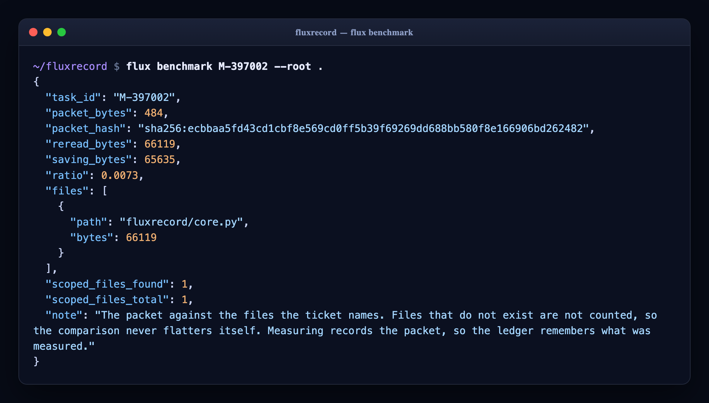
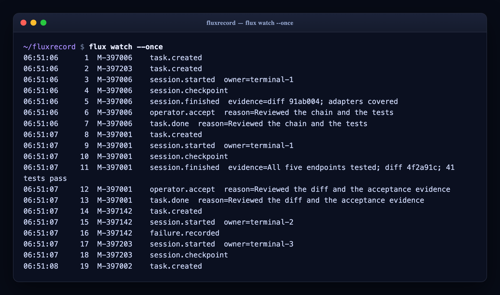
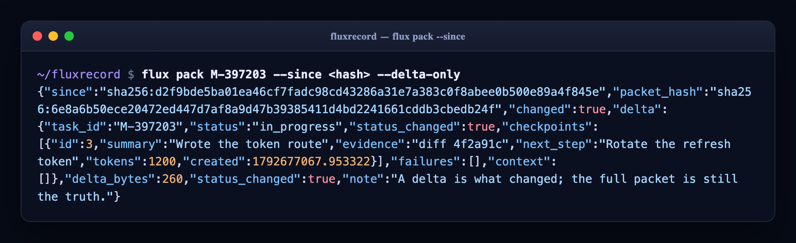
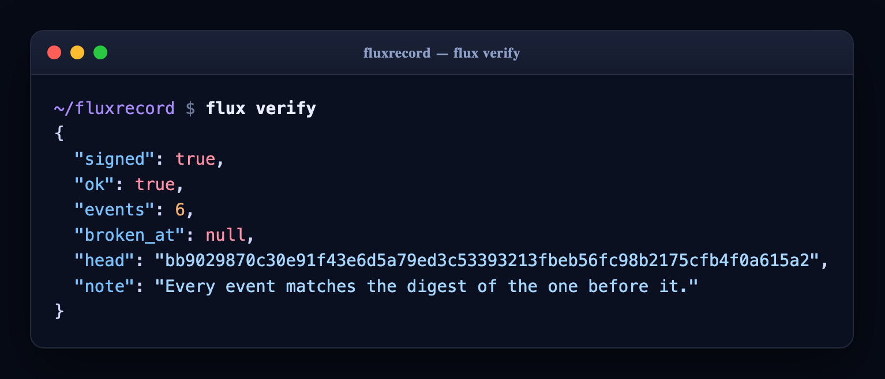
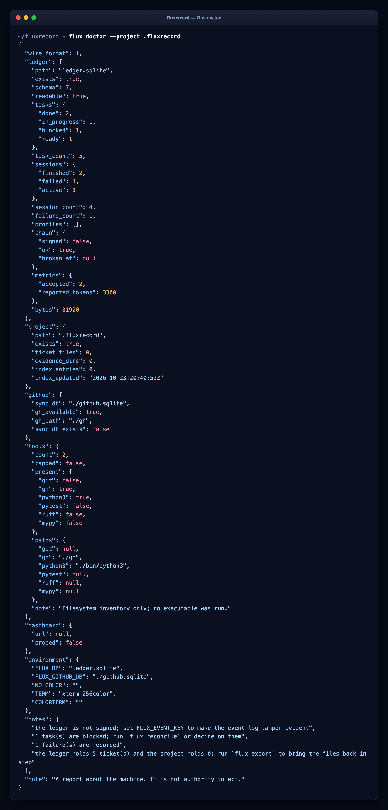

# fluxrecord

```text
▅▆▇███▇▆▅▃▂▁▁▁▂▃▄▆▇███▇▆▅▃▂▁▁▁▂▃▄▆▇███▇▆▅▃▂▁▁▁▂▃▄▆▇███▇▆▅▃▂▁▁▁▂▃▄▆▇███▇▆▅▃▂▁▁▁▂▃▄▆▇█
█▀▀▀▀  █      █   █  █   █  █▀▀▀▄  █▀▀▀▀  ▄▀▀▀▀  ▄▀▀▀▄  █▀▀▀▄  █▀▀▀▄
█▄▄▄   █      █   █  ▀▄ ▄▀  █▄▄▄▀  █▄▄▄   █      █   █  █▄▄▄▀  █   █
█      █      █   █   ▄▀▄   █ ▀▄   █      █      █   █  █ ▀▄   █   █
█      █▄▄▄▄  ▀▄▄▄▀  █   █  █   █  █▄▄▄▄  ▀▄▄▄▄  ▀▄▄▄▀  █   █  █▄▄▄▀
  Less repeated context. More accepted work. Visible failures.
```

[](https://github.com/hamanakam1/fluxrecord/actions/workflows/ci.yml)
[](LICENSE)
[](https://www.python.org/)
[](pyproject.toml)
[](https://github.com/hamanakam1/fluxrecord/releases)

---

fluxrecord is a **ticket standard** for local-first, evidence-driven coordination — built for people working across AI coding agents, CLIs, and terminal sessions.

> **Less repeated context. More accepted work. Visible failures.**

---

## Quick Start

```bash
# Initialize a fluxrecord project (ledger + .fluxrecord/ layout)
flux init --project .fluxrecord

# Create a ticket
flux task-add M-397001 \
  --objective "Implement JWT auth" \
  --acceptance "Tokens issued + refresh + revoke work" \
  --scope repo/api --scope repo/auth \
  --budget 8000

# Start work (acquires lease)
flux start M-397001 --owner terminal-1 --lease 900

# Record progress (cumulative tokens)
flux checkpoint <session_id> \
  --summary "Implemented token issuance" \
  --evidence "Diff abc123; POST /api/auth/login works" \
  --next "Refresh rotation" \
  --tokens 1200

# Finish (requests review)
flux finish <session_id> --evidence "All endpoints tested; diff abc123"

# Operator accepts → DONE
flux decide M-397001 accept --reason "Reviewed diff and tests"

# Write the tickets and their evidence to the project directory
flux export --project .fluxrecord
```

### The whole loop, in one ticket


---

## Core Principles

| Principle | Practice |
|-----------|----------|
| **Bounded context** | Every ticket carries objective, acceptance, scope, budget |
| **Explicit ownership** | `start()` acquires lease; expiry blocks until reconciliation |
| **Evidence at every step** | `checkpoint()` requires summary + evidence + next step + cumulative tokens |
| **Acceptance ≠ execution** | `finish()` → REVIEW → operator `decide(accept)` → DONE |
| **Failures are first-class** | Categories, stable fingerprints, recurrence tracking |
| **Accepted work only** | `decide(accept)` → DONE; nothing ships without review |

---

## Quick Reference

### Ticket Lifecycle
```
READY → IN_PROGRESS ↔ BLOCKED → REVIEW → ACCEPTED → DONE
               ↑    ↓
               └─── retry (preserves tokens)
```

A ticket is created ready to work. Acceptance is the gate: `finish()` only
creates a review, and only an operator decision creates a done.

### Key Commands
| Command | Purpose |
|---------|---------|
| `flux task-add <id> --objective "..." --acceptance "..." --scope repo/x` | Create ticket |
| `flux start <id> --owner <name> --lease 900` | Start work (acquire lease) |
| `flux checkpoint <sid> --summary "..." --evidence "..." --next "..." --tokens <n>` | Record progress |
| `flux renew <sid> [--lease 900]` | Extend the lease on an active session |
| `flux handoff <sid> --to <owner> --reason "..."` | Hand a lease to another worker |
| `flux adopt <sid> --owner <owner> --reason "..."` | Take over a lease whose owner has gone away |
| `flux watch [--after N] [--once] [--json]` | Print new events as they land |
| `flux verify [--signed]` | Check that the event log has not been edited |
| `flux compact [--keep 100]` | Fold the oldest events into a summary |
| `flux reconcile` | Expire leases that have run out |
| `flux fail <sid> --category tool --summary "..."` | Record failure |
| `flux finish <sid> --evidence "..."` | Request review |
| `flux decide <id> accept\|retry\|cancel --reason "..."` | Operator decision |
| `flux accept\|retry\|cancel <id> --reason "..."` | The same decision, one command per outcome |
| `flux init [--project .fluxrecord]` | Create the ledger and the project layout |
| `flux export [--project .fluxrecord]` | Write tickets and evidence as files |
| `flux read <file>` | Read an exported ticket file back |
| `flux import --file tickets.csv [--dry-run] [--reassign]` | Import a CSV backlog into the ledger |
| `flux status` | Ledger state, metrics and failure history |
| `flux status --summary` | The board: one line per ticket, for a person to read |
| `flux list [--status S] [--priority N] [--tag T] [--scope S] [--owner O] [--compact]` | List tickets with filters |
| `flux show <id>` | One ticket with its sessions, checkpoints, failures and events |
| `flux events [--after N] [--type T] [--task ID] [--limit N]` | The event log, as JSON |
| `flux sessions [--active]` | Who is holding what, and how much lease is left |
| `flux pack <id> [--max-bytes N] [--packet-only] [--since HASH] [--delta-only]` | Bounded context packet for a ticket |
| `flux context-add <id> --file F --source S` | Attach context to a ticket |
| `flux profile-add <id> --kind K --context-limit N --cost C` | Declare a profile |
| `flux route <id> [--required-context N]` | Eligible profiles for a ticket |
| `flux tools [--history] [--limit N]` | Local executable inventory |
| `flux dashboard-preview --url http://127.0.0.1:8080` | Bounded local dashboard preview |
| `flux dashboard-intake --url http://127.0.0.1:8080` | Turn dashboard tickets into ledger tickets |
| `flux github-poll --repo owner/repo` | Observe a repository |
| `flux github-status --repo owner/repo` | What has been observed, and what is queued |
| `flux github-publish --repo owner/repo --issue N --key K --body B` | Queue and publish a marked comment |
| `flux github-reconcile --repo owner/repo` | Confirm sent comments against the issue |
| `flux github-intake --repo owner/repo` | Turn observations into tickets |
| `flux github-cycle --config cycle.json` | One observe/reconcile/publish cycle |
| `flux art [--style large\|small\|mini\|minimal\|ascii] [--color]` | Print the wordmark |
| `flux version` | Package version |
| `flux benchmark <id> [--root .]` | Measure the context a ticket costs, against re-reading it |
| `flux doctor [--project .fluxrecord] [--dashboard URL]` | Report on the ledger, the project and the adapters |
| `flux token issue\|verify\|introspect ...` | Issue and check tokens |

---

## Wordmark

The mark is a signal in flight: a flux waveform riding above a half-block
letterform, with the brand line locked underneath. Five styles ship, and every
one of them is a single call away.

```bash
flux art                 # hero lockup
flux art --style small   # compact wordmark (what `flux init` prints)
flux art --style mini    # sparkline over the bare name
flux art --style ascii   # pure ASCII, no block glyphs
flux art --color         # ANSI gradient (respects NO_COLOR)
```

```text
█▀▀▀▀ █     █   █ █   █ █▀▀▀▄ █▀▀▀▀ ▄▀▀▀▀ ▄▀▀▀▄ █▀▀▀▄ █▀▀▀▄
█▄▄▄  █     █   █ ▀▄ ▄▀ █▄▄▄▀ █▄▄▄  █     █   █ █▄▄▄▀ █   █
█     █     █   █  ▄▀▄  █ ▀▄  █     █     █   █ █ ▀▄  █   █
█     █▄▄▄▄ ▀▄▄▄▀ █   █ █   █ █▄▄▄▄ ▀▄▄▄▄ ▀▄▄▄▀ █   █ █▄▄▄▀
  Less repeated context. More accepted work. Visible failures.
```

```text
▅▆▇███▇▆▅▃▂▁▁▁▂▃▄▆▇███▇▆▅▃▂▁▁▁▂▃▄▆▇███▇▆▅▃▂▁▁▁▂▃▄▆▇███▇▆▅▃▂▁▁▁▂▃
   fluxrecord
```

```text
##### #.... #...# #...# ####. ##### .#### .###. ####. ####.
#.... #.... #...# .#.#. #...# #.... #.... #...# #...# #...#
####. #.... #...# ..#.. ####. ####. #.... #...# ####. #...#
#.... #.... #...# .#.#. #.#.. #.... #.... #...# #.#.. #...#
#.... ##### ##### #...# #..#. ##### .#### .###. #..#. ####.
```

---

## Installation

```bash
pip install fluxrecord
# or
pip install git+https://github.com/hamanakam1/fluxrecord.git
```

Requires: **Python 3.11+**, `sqlite3` (stdlib)

---

## Architecture

```
fluxrecord/
├── fluxrecord/
│   ├── __init__.py
│   ├── __main__.py      # JSON-first CLI
│   ├── ascii_art.py     # The wordmark, in five styles
│   ├── core.py          # Ledger: tasks, sessions, checkpoints, contexts, profiles
│   ├── files.py         # Ticket file storage (.fluxrecord/ layout)
│   ├── tools.py         # Local executable inventory
│   ├── dashboard.py     # Bounded GET-only ticket preview
│   ├── github_sync.py   # Durable GitHub observations + outbox
│   ├── github_cycle.py  # One observe/reconcile/publish cycle
│   ├── importer.py      # CSV backlog import
│   └── auth/            # JWT: jwt.py, middleware.py, routes.py
├── tests/
├── templates/           # Ticket and checkpoint templates
└── SPEC.md              # Full specification
```

The core ledger is stdlib-only: no network, no shell, no telemetry. The
adapters around it each declare their own boundary, and each one is
enforced rather than assumed.

| Component | Boundary |
|-----------|----------|
| `core` | stdlib only; no network, no shell, no telemetry |
| `dashboard` | loopback origins only; GET only; redirects refused; 8 MiB; 10 seconds |
| `github_sync` | the `gh` CLI only; fixed argv; 30 seconds; no token anywhere |
| `tools` | the filesystem only; nothing is ever executed |
| `auth` | HS256 only; stdlib only; no web framework |

Eligibility is not authorization, a finished session is not accepted work,
and a declared profile is not a verified one. The code keeps those apart
on purpose.

---

## Bringing a Backlog With You

`flux import` maps a CSV backlog onto the ticket model: the file column
becomes the scope, so conflicts are detectable; the epic and category become
tags; P0..P3 become priorities 1..3; and the id doubles as a seed key, so
importing twice changes nothing.

```bash
flux import --file tickets.csv --dry-run   # see what would happen
flux import --file tickets.csv             # import it
```

The repository's own `tickets.csv` is the worked example — 98 rows that
reuse 31 ids. A reused id is reported as a conflict rather than silently
dropped; `--reassign` gives those rows a fresh sequential id instead and
reports the old and new id for each.

Collisions are checked against both the ledger and earlier rows using the
objective and acceptance text. A dry run applies the same identity decisions
for valid rows without writing or reconciling sessions; full task validation
still happens during import. Newly reassigned rows retain a seed derived from
their original ID and content, so a repeated import reuses the same task.
Older reassigned tasks stored only their new ID; their original mappings are
not inferred or migrated.

---

## GitHub Sync

`flux github-poll` observes a repository and writes what it saw into a
durable store: every revision of every issue, comment, pull, review
comment, release, run, commit and event, each implying one of six actions.
The `gh` CLI is the only way out — no token is read or stored anywhere, and
every call is bounded by a 30 second timeout.

Writing is idempotent. A queued comment carries a
`<!-- fluxrecord:{key}:{digest} -->` marker, and `publish` matches that
marker before sending anything, so a retry confirms instead of
double-posting. The namespace used to be `taskrivet`; that form is still
read, so a comment published by an earlier version is recognised and
never sent twice.

```bash
flux github-poll --repo owner/repo
flux github-status --repo owner/repo
flux github-publish --repo owner/repo --issue 123 --key summary --body "..."
flux github-reconcile --repo owner/repo
flux github-cycle --config templates/github-cycle.json
```

A cycle is described by a JSON file — see
[`templates/github-cycle.json`](templates/github-cycle.json). Nothing is
published unless the config sets `"publish": true`. The optional `publish`
and `intake` flags accept only JSON booleans and default to `false`; strings
such as `"false"`, numbers, and `null` are rejected before opening a database
or calling GitHub. A repository that fails is recorded and skipped rather
than stopping the cycle.

### From Observation to Ticket

The dashboard is another source of work, watched the same way a repository
is. `flux dashboard-intake` reads the local dashboard and gives each of
its tickets a ledger ticket, seeded by the dashboard's own id so reading it
twice does not create two tickets.

```bash
flux dashboard-intake --url http://127.0.0.1:8080
```


Observing a repository is only half the job. `flux github-intake` turns
what was observed into work:

- an observation that implies an action becomes a ticket — a failed check
  to investigate, a pull request to review, feedback to answer — with the
  observation attached as its context
- an observation that names a fluxrecord ticket lands on that ticket
  instead of becoming a new one
- an observation that implies nothing — a successful run, a merged pull, a
  commit — stays an observation

```bash
flux github-poll --repo owner/repo
flux github-intake --repo owner/repo
```

Each ticket is seeded with `gh:{repo}#{kind}#{identity}`, so intake can
run on a schedule without turning one pull request into a hundred
tickets. The ticket's scope is the external item, so two people working
the same issue still conflict.

---

## Authentication

`fluxrecord.auth` is a JWT implementation with no third-party crypto and no
web framework: HMAC-SHA256 by hand, base64url by hand, and a dispatcher that
takes a method, a path, a body and headers.

```python
from fluxrecord.auth import AuthRoutes

routes = AuthRoutes(secret, issuer="fluxrecord", audience="api",
                    verify_credentials=check_credentials)

response = routes.handle("POST", "/api/auth/login",
                          {"username": "terminal-1", "password": "..."})
response.body["access_token"]
```

Routes: `login`, `refresh`, `revoke`, `introspect` (RFC 7662) and `logout`.
Errors come back as RFC 7807 problems.

From a shell, the same module is three commands:

```bash
export FLUX_TOKEN_SECRET=...          # never pass a secret as an argument
flux token issue --subject terminal-1 --scope read --ttl 300
flux token verify "$TOKEN"
flux token introspect "$TOKEN"
```

A secret in an argument is a secret in the shell history and in the
process table, so the signing secret comes from the environment (or from
a file named by `FLUX_TOKEN_SECRET_FILE`) and never from the command
line.

A dashboard that is protected can then be previewed with that token:

```bash
flux dashboard-preview --url http://127.0.0.1:8080 --token "$TOKEN"
```

The rules that matter are enforced rather than assumed: the algorithm is
fixed to HS256 and read from the header rather than trusted from it, so
`alg: none` and algorithm confusion are refused; signatures are compared
with `hmac.compare_digest`; `exp`, `nbf`, `iss` and `aud` are checked on
every verification; refresh tokens rotate and are spent once; and every
token carries a `jti`, so it can be revoked.

---

## The Board

`flux status --summary` is the ledger as something a person can read: one
line per ticket with its status, owner, age, tokens, last evidence and
open failures. It is all fact — nothing there is an estimate of work
nobody measured.

```bash
flux status --summary
flux status --summary --status in_progress
```

---

## Doctor

`flux doctor` asks every part of the package what it knows and puts the
answers together: the ledger and its schema, the project directory and
whether it is in step with the ledger, what the GitHub adapter has
observed, which tools are installed, and the environment.

```bash
flux doctor
flux doctor --project .fluxrecord --dashboard http://127.0.0.1:8080
```

It ends with notes rather than a verdict: what is blocked, what is
waiting for review, what is stale, and which command would move it.

---

## Many Workers, One Ledger

Two workers cannot hold the same ticket: `start()` refuses a ticket whose
scope overlaps one that is in progress, blocked or in review. When a worker
has to let go, it says so rather than going quiet:

```bash
flux handoff <session_id> --to terminal-2 --reason "going home"
flux adopt <session_id> --owner terminal-2 --reason "the old worker is gone"
```

Both are recorded in the event log, with the reason, because a lease that
changes hands without a reason is one nobody can explain later.

### Watching, Without a Server

The roadmap asked for WebSocket updates. A socket means a server, a port, an
origin check and a deployment story — all of which contradict a
local-first CLI whose core promises no network. The event log is already
a table in the same file the reader has open:

```bash
flux watch              # print new events as they land
flux watch --json       # one JSON object per event
```

---

## Tamper-Evidence

A ledger on a shared volume can be edited by anyone with write access.
Give it a chain key and every event carries the digest of the one before
it, so a silent edit is detectable:

```bash
export FLUX_EVENT_KEY=...      # never pass a secret as an argument
flux verify                    # "ok": true
flux verify --signed           # fails when the ledger is not signed
```

The chain is off by default: a ledger nobody signs is still a ledger, and
`flux verify` says so rather than pretending to have checked something.

The event log is the ledger's memory, and memory grows. `flux compact`
folds the oldest events into a summary and prunes them, and the chain
still verifies afterwards: the digest of the last pruned event is kept as
the base the remaining events chain onto.

A chain is a prefix, so the head of the chain is recorded beside the log
and compared on every check. That catches a log truncated at the end as
well as one edited in the middle. What it proves is that the log has not
been edited *by somebody who does not have the key*: without the key, an
editor cannot compute a valid digest for a changed event. It is evidence,
not protection — and the head is in the same file as the log, so somebody
who can write to one can write to the other.

---

## When Things Go Wrong

The ledger is built for the case where a worker stops without saying
goodbye. A lease that runs out blocks its ticket, records a
`lease_expired` failure, and keeps the resource reserved until an
operator releases it — so a dead worker cannot be half-replaced by
accident.

```bash
flux adopt <session_id> --owner terminal-2 --reason "the old worker is gone"
```

A transaction that is cut in half leaves nothing behind, a killed process
leaves a ledger that still opens, and the event chain still verifies.
Those are checked by a chaos suite that kills things on purpose, because
the rules that matter under failure are the ones a worker cannot check
for itself.

---

## The Standard

The JSON this package emits is a contract with other tools, so it is
versioned and frozen. `flux version` says which version it speaks.

- [`docs/wire-format.schema.json`](docs/wire-format.schema.json) — the
  frozen shapes, as a JSON Schema
- [`docs/identifiers.md`](docs/identifiers.md) — the `M-` ranges and the
  allocation rule
- [`docs/breaking-changes.md`](docs/breaking-changes.md) — what counts as
  a breaking change, how it is announced, and how long the old form is
  read

From wire format 1 onwards, changing the name of a field is a breaking
change. The ticket and the packet are frozen; the board and the session
list are views, and may grow a field.

And there is something to check it against:

```bash
python3 conformance/run.py --command "my-ledger"
```

The [conformance suite](conformance/README.md) runs a fixed sequence of
commands against an implementation and checks every report against the
published schema. It knows nothing about fluxrecord's internals, so
"fluxrecord-compatible" means something a third party can check for
themselves. This implementation passes it, and the suite is required to
reject an implementation that does not.

---

## Threat Model

What fluxrecord protects, from whom, and what it has decided not to solve,
is written down in [docs/threat-model.md](docs/threat-model.md). The
decisions that shape it — why the auth module is a library and not a
service, and what that costs — are in
[docs/adr/0001-auth-is-a-library.md](docs/adr/0001-auth-is-a-library.md).

Both name what is accepted rather than solved. A ledger on a shared
volume can still be edited by anyone with write access; the signed event
chain makes the edit detectable, not impossible.

---

## Ticket Files

The ledger is the source of truth; `flux export` projects it onto disk so
tickets can be read, diffed and reviewed without opening the database.

```
.fluxrecord/
├── tickets/
│   └── M-397001.md          # front matter + description + evidence log
├── index.json               # { "M-397001": { "title": ..., "status": ... } }
└── evidence/
    └── M-397001/
        ├── checkpoint-1.json
        └── finish.json
```

The projection goes both ways: `flux read` reads a ticket file back, so a
tool that does not share the ledger can still read a ticket. The front
matter is the frozen shape of the file, and it is validated against the
published schema like everything else.

---

## Core Concepts

### Ticket = Bounded Context
```yaml
id: "M-397001"
title: "Implement JWT auth"
objective: "Implement JWT auth"
acceptance: "Tokens issued + refresh + revoke work"
kind: "code"
scope: ["repo/api", "repo/auth"]
token_budget: 8000
priority: 2          # 1=P1-Now 2=P2-Next 3=P3-Later
tags: ["security"]
depends_on: []
blocks: []
owner: "terminal-1"
seed_key: "auth-jwt-v1"   # idempotent seeding
```

Seeding is idempotent: re-running the same `--seed-key` returns the
existing ticket instead of creating a second one.

### Session = Leased Work
```bash
flux start M-397001 --owner terminal-1 --lease 900
# → {session_id, lease_until}
```

### Packet = Addressed, and Only What Changed

Every packet carries the hash of its content. The same ticket at the same
state always produces the same hash, so an unchanged packet can be reused
instead of sent again — and `flux pack --since <hash>` returns only what
landed since the last one.

```bash
flux pack M-397001
# → { "packet": {...}, "packet_hash": "sha256:...", "packet_bytes": 341 }

flux pack M-397001 --since sha256:07b5a274...
# → { "delta": { "changed": false, ... } }
```

That is where *less repeated context* stops being a slogan and becomes a
number: the delta is smaller than the packet, and the saving is the
difference. The delta says what changed — the checkpoints that landed, the
failures that were recorded, the context that was attached — and whether
the ticket itself moved.

### Measured, Not Claimed

The first promise is *less repeated context*. A promise nobody measures is
a marketing claim, so the tool measures it:

```bash
flux benchmark M-397001 --root .
```

Against this repository, a worker handed the packet for `M-397001` reads
**366 bytes** instead of **50,840 bytes** of `fluxrecord/core.py` — 0.7%
of the file, and a number anybody can reproduce with the command above.
Files that the ticket names but that do not exist are not counted, so the
comparison never flatters itself.



### Tokenizer and Budget

The byte budget is exact and always there. A token count appears only
when a tokenizer has been registered — a plug-in, not a dependency, so
the package stays stdlib-only and works on an air-gapped machine.

```python
from fluxrecord import tokenizers
from fluxrecord.core import Ledger

tokenizers.register(my_tokenizer)          # optional
with Ledger("ledger.sqlite", tokenizer=tokenizers.current()) as ledger:
    packet = ledger.pack("M-397001")        # now carries a token_count
```

The budget a ticket gets comes from a policy by kind — `code` gets 12000
bytes, `fix` gets 8000, `planning` gets 6000 — so `--max-bytes` is
something a caller can override, not something it has to remember.

### Checkpoint = Evidence + Progress
```bash
flux checkpoint <sid> \
  --summary "Implemented token issuance" \
  --evidence "Diff abc123; POST /api/auth/login returns pair" \
  --next "Refresh rotation" \
  --tokens 1200
```

### Finish → Review → Accept
```bash
flux finish <sid> --evidence "All endpoints tested; diff abc123"
# → status: review

flux decide M-397001 accept --reason "Reviewed diff and tests"
# → status: done
```

---

## Screenshots

Every image here is the real output of the real CLI, captured against a
throwaway ledger and rendered by
[`scripts/capture_screenshots.py`](scripts/capture_screenshots.py). They are
generated, never hand-edited: if the output changes, the images are
regenerated in the same commit.

| | |
|:--|:--|
|  |  |
|  |  |
|  |  |
|  |  |
|  |  |
|  |  |

---

## Roadmap

The short version is here; the long-term plan — phases, exit criteria, the
risks, and what this project will deliberately not build — is in
**[PLAN.md](PLAN.md)**.

- [x] Core ledger (SQLite + WAL, transactions, additive migrations)
- [x] JSON-first CLI (`flux`)
- [x] GitHub sync (observations + outbox)
- [x] Dashboard preview (bounded GET-only)
- [x] Ticket file storage (`.fluxrecord/` layout)
- [x] Local tooling inventory
- [x] JWT auth routes (login, refresh, revoke, introspect)
- [x] One status vocabulary — the specification and the code agree, and a
      test keeps them agreeing
- [x] The context saving measured — content-addressed packets, deltas, a
      budget policy, and a benchmark that puts the number in this file
- [x] Coordination — lease handoff, adoption, and `flux watch`: real-time
      with no server and no socket
- [x] A written threat model, and an event log that detects an edit
- [x] The wire format frozen — published as a generated JSON Schema, with a
      conformance suite that can check somebody else's implementation
- [ ] Federation between ledgers, and read-only renderers

**Removed from the roadmap:** Kubernetes manifests and a Helm chart. There
is no server component to deploy, and a local-first CLI with no server has
nothing to put in a chart. It comes back only if a server is earned rather
than assumed. The same goes for a plugin system: a plug-in may read the
ledger and print, and may not import the core's internals, reach the
network, or run other plug-ins.

---

## Legacy

`manage_tickets.py` and `tickets.csv` are the pre-ledger prototype: a CSV
backlog with a reporting script on top. The ledger now does the enforcing
that the script only reported on. `flux import` reads the same CSV, and
`flux list` replaces the reporting.

---

## Contributing

```bash
python3 -m unittest discover -s tests -v
```

The suite covers the ledger, the adapters and the documented interface, and
includes property-based tests for the rules that must hold for any input:
cumulative tokens never decrease, the budget is enforced, three identical
checkpoints are a failure, and the context packet never exceeds its byte
budget.

See [CONTRIBUTING.md](CONTRIBUTING.md) for guidelines.

---

## Changelog

See [CHANGELOG.md](CHANGELOG.md) for what changed in each release.

---

## License

MIT — see [LICENSE](LICENSE)
